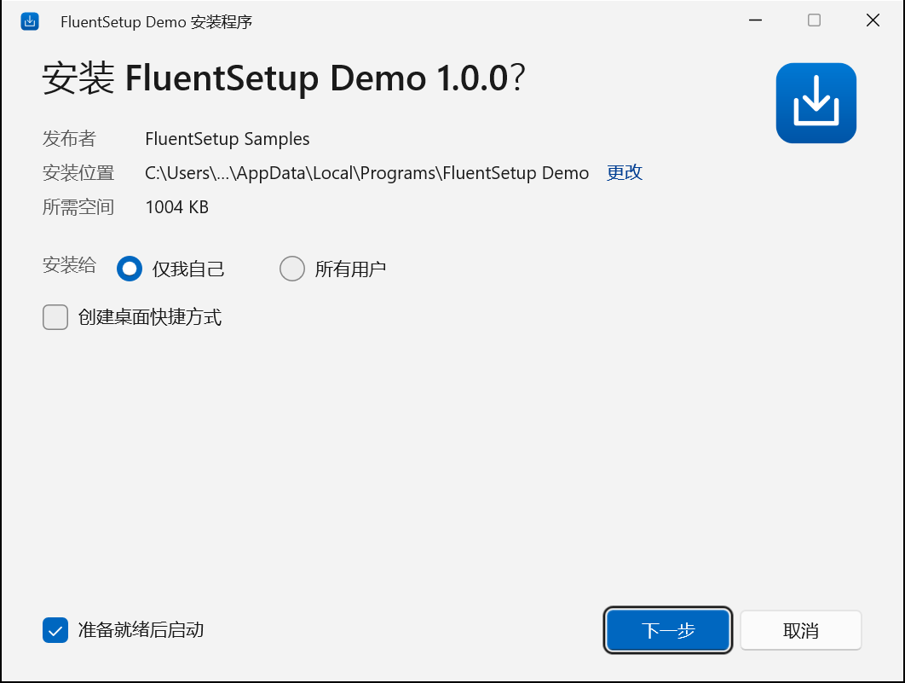

# FluentSetup

**A lightweight builder for native, Windows 11-style installers.** You describe your app in one JSON file, and
FluentSetup turns it into a single `Setup.exe`. That file installs, upgrades, rolls back and uninstalls your app,
with a Fluent WinUI 3 interface and no .NET, VC++ redistributable, WebView2 or network access needed at install time.

[中文说明](README.zh-CN.md)



## Highlights

- **Small.** Under 1 MiB of installer overhead for a typical app (stub + WinUI front end + metadata), checked
  against a 5 MiB budget in CI. See [docs/size-report.md](docs/size-report.md).
- **Native and self-contained.** A C++20 bootstrapper with a statically linked VC runtime and a built-in zstd
  decoder. The WinUI 3 front end is used when the Windows App Runtime is on the PC. Otherwise a Win32 front end with
  the same layout takes over, without restart loops or repeated side effects.
- **Safe installs.** A write-ahead journal and backups of replaced files give byte-for-byte rollback on failure or
  cancel. Unsafe install paths are refused. Per-file SHA-256 and Authenticode checks catch corrupted or tampered
  packages. Elevation goes through a separate worker that installs only its own embedded package.
- **Complete lifecycle.** Per-user or per-machine installs, upgrade, reinstall, downgrade protection, Apps & features
  registration, shortcuts, a self-removing `uninstall.exe`, silent mode, and adopting an existing install of the
  same app made by another installer.
- **Drop-in replacement for Inno Setup and NSIS.** Takes over their installations in place and understands the command
  lines in-app updaters already use (`/SILENT /RELAUNCH=1`, `/S /UPDATE`, `/DIR=`, `/TASKS=`, …), so apps can switch
  in a patch release. See [four real migrations](docs/thrm.md).
- **Prerequisites with version checks.** .NET Framework, .NET (Core) runtimes, WebView2, the Windows App Runtime, the
  Visual C++ Redistributable and any prerequisite you detect by registry value or file, each with a minimum version.
  A missing or outdated one is installed from Microsoft's official installer (stored in Setup.exe at build time, or
  downloaded by setup and accepted by its Microsoft signature), from a bundled installer or a verified https
  download, or setup stops with a help link. The Builder suggests current versions straight from Microsoft.
- **Desktop integration.** File types, URL schemes, extra shortcuts (Startup folder, arguments, AppUserModelID for
  toast notifications), registry values, environment variables, App Paths, Windows services, firewall rules, a
  Settings page for values such as a server address, and JSON/INI config files. Registry and config changes are rolled
  back with the files; everything is removed on uninstall.
- **Change and repair.** Apps & features "Modify" lets users switch shortcuts and options later or repair a damaged
  installation (from the original Setup.exe or the update source). Programs that hold the app's files are closed and
  restarted through Windows Restart Manager; files still in use can be replaced at the next restart.
- **Declarative extensions.** Close running processes, required (locked) and optional components, payload programs
  after install or before uninstall with fallbacks, NGen, PATH, and cleanup of legacy tasks, Run entries, shortcuts,
  files, registry keys and uninstall keys.
- **Signed end to end.** Sign with a certificate, Azure Trusted Signing or any signing command; the uninstaller setup
  writes is signed too, and setup shows the verified publisher.
- **Built-in updates.** Point the project at GitHub releases or a JSON feed and the installed app can update itself:
  `uninstall.exe /install-update` checks, asks, downloads, verifies (SHA-256, same app, newer version, optional
  signer) and installs; `/check-update` only reports. No updater code in the app.
- **Variants.** One package can carry a self-contained and a framework-dependent build of the same app (shared files
  stored once); the user picks at install time, or `--variant` builds a single-variant package.
- **Accessible and localized.** English, Simplified and Traditional Chinese, Japanese, Korean, German, French, Spanish,
  Brazilian Portuguese, Russian and Italian built in, following the Windows display language; any other language can be
  added by a package (`fluentsetup locale add nl-NL`). UI Automation names, keyboard navigation,
  light/dark/high-contrast themes, and per-monitor DPI.
- **Three ways to build:** the Builder app, the `fluentsetup` CLI (also as a GitHub Action), or the `Builder.Core`
  library.
- **Made for AI-assisted authoring.** `fluentsetup guide` prints a complete authoring guide, `fluentsetup schema` the
  JSON Schema, and `fluentsetup validate --json` machine-readable diagnostics with codes and field paths.

## Quick start

### 1. Install FluentSetup

Download from the [latest release](https://github.com/TIANLI0/FluentSetup/releases/latest):

- **`FluentSetup-<version>-Setup.exe`**: the Builder app and the `fluentsetup` command-line tool (put on PATH).
  Setup installs the .NET 10 runtime and the Windows App Runtime if they are missing. Windows 10 1809 or later.
- **`fluentsetup-<version>-win-x64.zip`**: the command-line tool alone, self-contained (no .NET needed). Unzip it
  anywhere; for build servers and scripts.

FluentSetup keeps itself up to date: the Builder looks for a new release once a day (Settings > Updates turns this
off) and installs it when you click **Update**; on the command line, `fluentsetup update` does the same and
`fluentsetup update --check` only reports. Downloads are verified against the release's `SHA256SUMS.txt`.

### 2. Describe your app

In the **Builder** app: *New project*, pick the folder with your app's build output (for example
`bin\Release\publish`), fill in the name, ID and publisher, then go through the pages: files, install options,
prerequisites, options and actions, upgrade, uninstall, appearance. Problems are listed as you type.

Or with the command line:

```powershell
fluentsetup init my-app --name "My App" --id Contoso.MyApp --source C:\build\MyApp\bin --publisher Contoso
```

Both create a `fluentsetup.json`. A minimal one looks like this:

```json
{
  "$schema": "https://raw.githubusercontent.com/TIANLI0/FluentSetup/main/shared/schemas/fluentsetup.project.schema.json",
  "schemaVersion": 1,
  "app": { "id": "Contoso.MyApp", "name": "My App", "publisher": "Contoso", "version": "1.0.0", "mainExecutable": "MyApp.exe" },
  "files": { "source": "bin", "include": ["**/*"], "exclude": ["**/*.pdb"] },
  "install": { "scope": "userOrMachine", "defaultScope": "user", "desktopShortcut": "optionalOff", "launchAfterInstall": "optionalOn" },
  "ui": { "license": "LICENSE.txt" },
  "output": { "fileName": "{AppName}-{Version}-Setup.exe", "compression": "normal" }
}
```

Every setting is explained in [docs/project-file.md](docs/project-file.md); `fluentsetup guide` prints a complete
authoring guide (also useful for AI assistants).

### 3. Build Setup.exe

Click **Build** in the Builder app, or:

```powershell
fluentsetup validate my-app\fluentsetup.json          # errors and warnings with codes and field paths
fluentsetup build my-app\fluentsetup.json             # -> my-app\dist\My App-1.0.0-Setup.exe
fluentsetup inspect "my-app\dist\My App-1.0.0-Setup.exe" --verify
```

Run the result to try it, or test it unattended: `Setup.exe /quiet /log setup.log`, then
`"<install folder>\uninstall.exe" /uninstall /quiet`.

### 4. Build in CI

The GitHub Action installs the command-line tool (verified download) on a Windows runner:

```yaml
- uses: TIANLI0/FluentSetup@v1.2.0
- run: fluentsetup build installer/fluentsetup.json -D Version=1.2.3
```

`-D Version=1.2.3` fills `$(Version)` placeholders in the project (`"version": "$(Version)"`), so the version comes
from your release pipeline.

### Switching from Inno Setup or NSIS

Keep your app's uninstall key (`install.adoptExistingInstall` or `install.legacyUninstallKeys`), the release file
name your in-app updater downloads (`output.fileName`) and the command line it runs: existing installations are then
updated in place, including updates started from the old version. [docs/thrm.md](docs/thrm.md) shows how
[THRM](https://github.com/TIANLI0/THRM), [EncoDeck](https://github.com/TIANLI0/EncoDeck),
[PinyinFlux](https://github.com/TIANLI0/PinyinFlux) and [MediaDuet](https://github.com/TIANLI0/MediaDuet) did it.

## Setup.exe command line

What your users and their administrators can run:

```
Setup.exe [/quiet | /S | /passive] [/uninstall] [/dir <path>] [/scope user|machine] [/relaunch]
          [/desktop-shortcut yes|no] [/start-menu-shortcut yes|no] [/option <id>=yes|no]
          [/input <id>=<value>] [/log <file>] [/lang <language>] [/ui auto|winui|win32]
uninstall.exe /modify | /repair [/quiet]                                        (Apps & features "Modify")
uninstall.exe /check-update | /install-update [/passive | /quiet] [/relaunch]   (with an update source)
```

Exit code 0 means success. All other codes are listed in [docs/diagnostics.md](docs/diagnostics.md). Inno Setup and
NSIS switches are understood too ([details](docs/project-file.md#setupexe-command-line)).

## Documentation

- [Project file reference](docs/project-file.md)
- [Migrating from Inno Setup and NSIS: case studies](docs/thrm.md), and [importing an .iss or .nsi script](docs/import.md)
- [winget and Microsoft Store](docs/winget.md), [MSBuild, .NET tool and library](docs/msbuild.md),
  [building on Linux and macOS](docs/cross-platform.md)
- [Diagnostics](docs/diagnostics.md): exit codes, logs, recovery
- [Security](docs/security.md): threat model and mitigations
- [Architecture](docs/architecture.md): components, process model, install state machine, fallback rules
- [Package format](docs/package-format.md): the `Setup.exe` container
- [UI/worker protocol](shared/protocols/ui-protocol.md)
- [Size report](docs/size-report.md)
- [Changelog](CHANGELOG.md)

## Development

Building FluentSetup itself needs Windows 10 1809+ (Windows 11 recommended), Visual Studio 2022 or newer with
*Desktop development with C++*, and the .NET 10 SDK.

```powershell
git clone https://github.com/TIANLI0/FluentSetup.git
cd FluentSetup
.\scripts\build.ps1                       # native runtime, WinUI front end, CLI, Builder app, tests
.\scripts\package-release.ps1             # the release files, in out\release
```

The CLI built from source is `src\CLI\bin\Release\net10.0\fluentsetup.exe`.
[samples/DemoApp](samples/DemoApp) is the app the tests package.

| Path | What |
|---|---|
| `src/Bootstrapper` | `FluentSetup.Stub.exe`: entry point, controller, elevation, runtime probe, WinUI host |
| `src/Install.Core`, `src/Install.Worker` | Install engine (state machine, journal, rollback, uninstall, extensions), elevated worker |
| `src/Archive`, `src/IPC`, `src/Common` | Container reader + zstd, named-pipe IPC, JSON/crypto/path/security helpers |
| `src/Setup.WinUI`, `src/Setup.Win32` | C++/WinRT WinUI 3 front end, Win32 fallback front end |
| `src/Builder.Core`, `src/CLI`, `src/Builder` | C# packaging library, `fluentsetup` CLI, WinUI 3 Builder app |
| `shared` | Localization strings, JSON schema, IPC protocol |
| `tests` | Native unit tests, Builder.Core tests, end-to-end install tests, UI Automation tests |
| `docs` | Architecture, package format, security, diagnostics, size report |

### Tests

```powershell
.\out\bin\x64\Release\FluentSetup.Tests.Native.exe        # native unit/security tests
dotnet test tests\Builder.Core.Tests -c Release           # builder tests
.\tests\Integration\e2e.ps1                               # real per-user installs: upgrade, rollback, uninstall, ...
.\tests\UI\ui-tests.ps1                                   # drives both front ends with UI Automation
.\scripts\size-report.ps1                                 # fails above the 5 MiB budget
```

The end-to-end and UI tests install and remove a test app for the current user only. They do not need administrator
rights. To keep using the PC while they run, start them on an invisible desktop at idle priority: their windows never
appear on your screen or take the mouse and keyboard (UI tests talk to windows through UI Automation and window
messages only):

```powershell
.\scripts\run-hidden.ps1 -Command 'powershell -NoProfile -File tests\UI\ui-tests.ps1' -Log out\ui-tests.log
```

Releases: push a tag `vX.Y.Z` with a matching `## [X.Y.Z]` section in [CHANGELOG.md](CHANGELOG.md); the release
workflow builds, tests and publishes the files above.

## License

[MIT](LICENSE). Third-party components are listed in [THIRD-PARTY-NOTICES.md](THIRD-PARTY-NOTICES.md).
