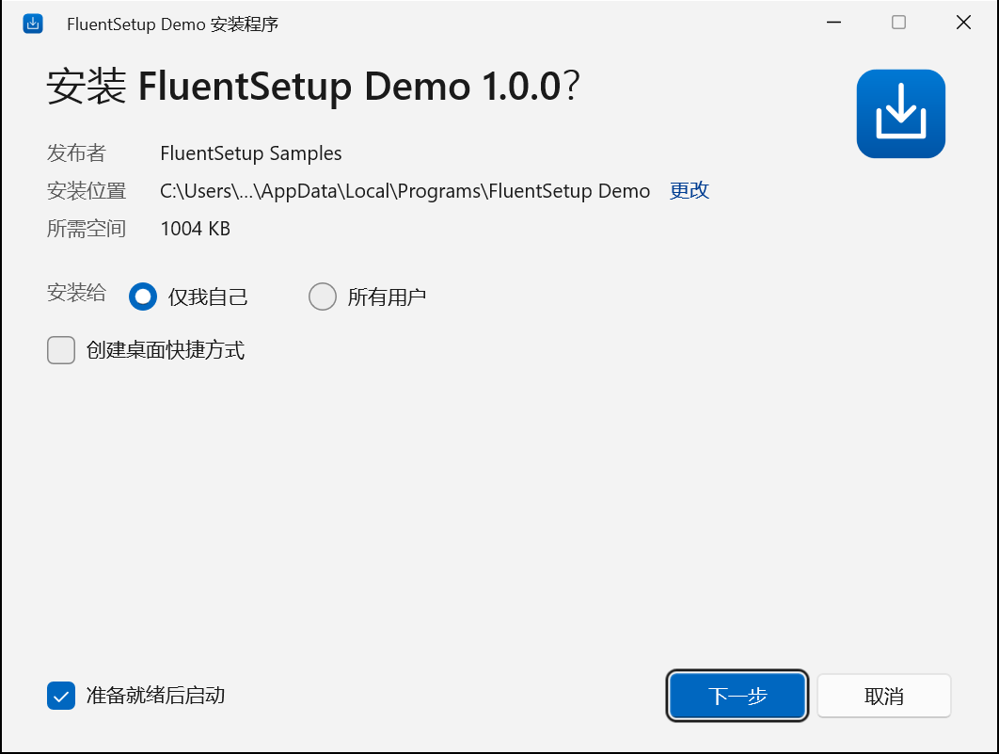

# FluentSetup

**轻量级、原生 Windows 11 风格的安装包制作工具。** 用一个 JSON 文件描述你的应用，FluentSetup 生成单个 `Setup.exe`。它负责安装、升级、回滚和卸载，界面是 Fluent 风格的 WinUI 3。安装时不需要 .NET、VC++ 运行库、WebView2，也不联网。

[English](README.md)



## 特性

- **体积小**：典型应用的安装器开销不到 1 MiB（stub + WinUI 界面 + 元数据），CI 中按 5 MiB 预算自动检查。详见 [docs/size-report.md](docs/size-report.md)。
- **原生、自包含**：C++20 引导程序，静态链接 VC 运行时，内置 zstd 解码器。系统装有 Windows App Runtime 时使用 WinUI 3 界面，否则自动切换到布局相同的 Win32 界面，不会循环重启，也不会重复执行有副作用的步骤。
- **安装可靠**：预写日志加被替换文件的备份，失败或取消时逐字节回滚；拒绝不安全的安装路径；逐文件 SHA-256 和 Authenticode 校验，能发现损坏或被篡改的安装包；提权由独立的 worker 进程完成，它只安装自身内嵌的安装包。
- **完整生命周期**：按用户或按机器安装，升级、重新安装、防降级，注册到“应用和功能”，快捷方式，可自删除的 `uninstall.exe`，静默模式，还能接管由其他安装程序安装的同一应用。
- **声明式扩展**：关闭正在运行的进程；检查前置条件（.NET Framework、WebView2，可附带安装程序）；自定义复选框；安装后或卸载前运行安装包内的程序；卸载时清理计划任务、Run 启动项和应用数据。
- **无障碍与本地化**：英文和简体中文，跟随 Windows 显示语言；UI 自动化名称、键盘导航、浅色/深色/高对比度主题、按显示器 DPI 缩放。
- **三种制作方式**：`fluentsetup` 命令行、WinUI 3 图形化 Builder，或直接调用 `Builder.Core` 库。

## 快速开始

构建要求：Windows 10 1809 及以上（推荐 Windows 11），Visual Studio 2022 或更高版本并安装“使用 C++ 的桌面开发”工作负载，.NET 10 SDK。

```powershell
.\scripts\build.ps1                      # 原生运行时、WinUI 界面、CLI、Builder、测试

$fs = '.\src\CLI\bin\Release\net10.0-windows10.0.19041.0\fluentsetup.exe'
& $fs init my-app --name "My App" --id Contoso.MyApp --source C:\build\MyApp\bin --publisher Contoso
& $fs validate my-app\fluentsetup.json
& $fs build my-app\fluentsetup.json      # -> my-app\dist\My App-1.0.0-Setup.exe
& $fs inspect "my-app\dist\My App-1.0.0-Setup.exe" --verify
```

项目文件参考见 [docs/project-file.md](docs/project-file.md)，JSON Schema 在 [shared/schemas](shared/schemas/fluentsetup.project.schema.json)。[samples/THRM](samples/THRM) 是一个真实项目示例，用到了前置条件、安装后动作和自定义选项（[说明](docs/thrm.md)）。

## Setup.exe 命令行

```
Setup.exe [/quiet | /S] [/uninstall] [/dir <路径>] [/scope user|machine]
          [/desktop-shortcut yes|no] [/start-menu-shortcut yes|no] [/option <id>=yes|no]
          [/log <文件>] [/lang en-US|zh-CN] [/ui auto|winui|win32]
```

退出代码 0 表示成功，其余代码见 [docs/diagnostics.md](docs/diagnostics.md)。

## 文档

- [架构](docs/architecture.md)
- [项目文件参考](docs/project-file.md)
- [安装包格式](docs/package-format.md)
- [界面/worker 通信协议](shared/protocols/ui-protocol.md)
- [安全](docs/security.md)
- [诊断与退出代码](docs/diagnostics.md)
- [体积报告](docs/size-report.md)

（详细文档为英文。）

## 测试

```powershell
.\out\bin\x64\Release\FluentSetup.Tests.Native.exe
dotnet test tests\Builder.Core.Tests -c Release
.\tests\Integration\e2e.ps1          # 真实的按用户安装：升级、回滚、卸载等
.\tests\UI\ui-tests.ps1              # 用 UI 自动化驱动两套界面
.\scripts\size-report.ps1
```

端到端测试和 UI 测试只为当前用户安装并移除一个测试应用，不需要管理员权限。

## 许可

[MIT](LICENSE)。第三方组件见 [THIRD-PARTY-NOTICES.md](THIRD-PARTY-NOTICES.md)。
