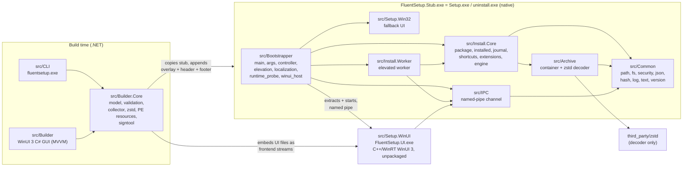
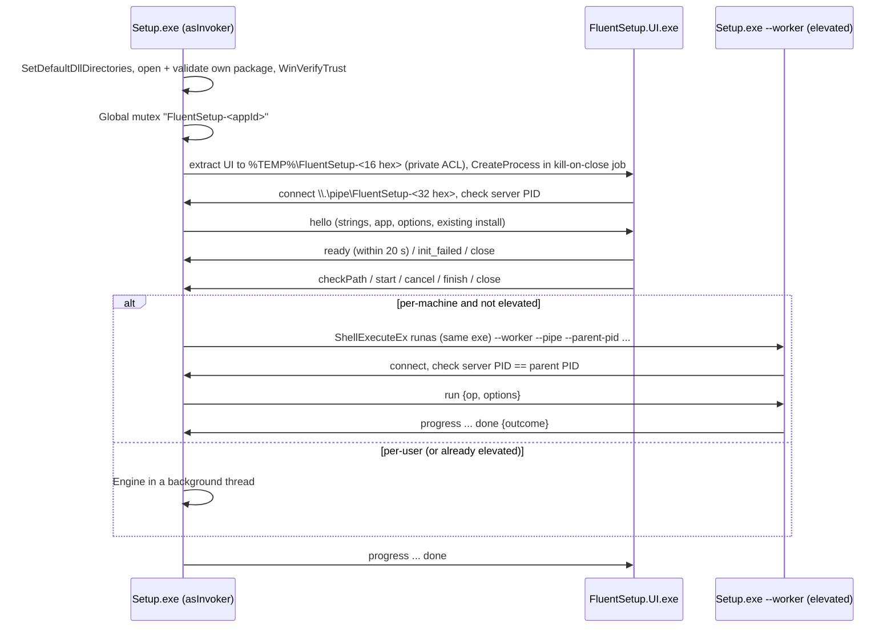

# FluentSetup architecture

This document describes how FluentSetup is put together, derived from the source code in this repository. Where a
feature is only partially implemented, or a document referenced from the code does not exist yet, that is stated
explicitly.

FluentSetup has two halves:

* **Build time (managed, .NET 10):** `Builder.Core` turns a project file (`fluentsetup.json`) into a single
  `Setup.exe`. It is driven by the command-line tool (`src/CLI`) or the WinUI 3 GUI (`src/Builder`).
* **Run time (native, C++20):** every generated `Setup.exe` is a copy of `FluentSetup.Stub.exe` (bootstrapper, install
  engine, Win32 fallback UI and elevated worker in one PE) with a package appended. Optionally the package also carries
  the WinUI 3 front end `FluentSetup.UI.exe`, which is extracted and started as a child process.

## 1. Components



### 1.1 Native run-time libraries

| Component | Kind | Responsibility |
|---|---|---|
| `src/Common` | static lib | Building blocks shared by every native binary. `path` (all conversion of untrusted text into file-system paths: `ValidateRelative`, `ValidateAbsoluteSyntax`, containment checks, `TempRoot`, known folders), `fs` (link detection, `DeleteTree`, atomic writes, `\\?\` long paths), `security` (elevation check, private directories, the per-machine ACL), `json` (small bounded DOM parser/serializer), `hash` (SHA-256 and random tokens via CNG/BCrypt), `log`, `text`, `version` (1-4 numeric parts plus optional SemVer pre-release tag), `error` (the stable `ErrorCode` list that doubles as the process exit code). |
| `src/IPC` | headers + `pipe.cpp` | `ipc::Channel`: framed JSON messages (uint32 little-endian length + UTF-8 JSON, max 16 MiB) over an overlapped, single-instance local named pipe. `protocol.h` defines the protocol version (1), the UI exit codes (`0x20`-`0x26`) and timeouts (UI ready 20 s, connect 10 s). |
| `src/Archive` | static lib | The self-extracting container (`container.h/.cpp`): locates the footer (before the Authenticode certificate table, if any), validates header bounds and SHA-256, decodes streams with a streaming zstd decoder (`StreamReader`), copies the bare stub for the uninstaller, and runs `WinVerifyTrust`. Only the zstd **decompressor** from `third_party/zstd` is compiled (`common/*` + `decompress/*`, `ZSTD_LEGACY_SUPPORT=0`, `ZSTD_DISABLE_ASM`, `XXH_NAMESPACE=FSETUP_`). |
| `src/Install.Core` | static lib | The only code that changes the system. `package` parses and validates the header into a `Package`; `installed` reads/writes the Apps & features (ARP) entry, the install record (`uninstall.json`) and the pending-operation marker; `journal` is the write-ahead journal and rollback; `shortcuts` creates `.lnk` files through `IShellLinkW`; `extensions` implements the declarative extras (close processes, requirement checks, user options, actions, uninstall cleanup); `engine` runs install and uninstall. |

### 1.2 Native executables

| Component | Output | Responsibility |
|---|---|---|
| `src/Bootstrapper` + `src/Setup.Win32` + `src/Install.Worker` | `FluentSetup.Stub.exe` (project `src/Bootstrapper/FluentSetup.Stub.vcxproj`) | `main.cpp`: process entry, hardening, opening and validating its own package, logging, single-instance mutex, mode selection. `args.cpp`: strict command-line parser. `controller.cpp`: session state shared by both front ends (options, path checks, start/cancel, running the engine in-process or through the elevated worker, final result, launch-after-install). `elevation.cpp`: `ShellExecuteEx` with `runas`, and starting the app unelevated through Explorer when the process is elevated. `localization.cpp`: string tables. `runtime_probe.cpp`: Windows App Runtime presence check. `winui_host.cpp`: extracting and driving the WinUI front end. `Setup.Win32/fallback_ui.cpp`: the same pages built from Common Controls v6/UxTheme/DWM. `Install.Worker/worker.cpp`: the elevated worker entry point (`--worker`). |
| `src/Setup.WinUI` | `FluentSetup.UI.exe` + its DLL/PRI/XBF files in `out/bin/<platform>/<config>/ui/` | C++/WinRT WinUI 3 front end. Unpackaged (`WindowsPackageType=None`, `AppxPackage=false`), framework-dependent (`WindowsAppSDKSelfContained=false`), with the Windows App SDK auto-initializers turned off (`WindowsAppSdkBootstrapInitialize=false`, `WindowsAppSdkAutoInitialize=false`) and the XAML-generated `main` disabled (`DISABLE_XAML_GENERATED_MAIN`). `main.cpp` parses arguments, connects to the bootstrapper pipe and verifies the server PID, then loads `Microsoft.WindowsAppRuntime.Bootstrap.dll` from its own directory with `LoadLibraryExW` and calls `MddBootstrapInitialize2` (no "install the runtime" UI) for the exact release it was compiled against, and only then calls `Application::Start`. Every failure is reported to the bootstrapper (`init_failed` message and a classified exit code). The UI holds no installer logic; it receives all text, options and state through the pipe. A `--preview <hello.json>` mode renders the pages from a file without a pipe (used by the Builder GUI). |

### 1.3 Managed build-time components

| Component | Responsibility |
|---|---|
| `src/Builder.Core` (`net10.0-windows10.0.19041.0`) | `Model/` project model and serializer (unknown properties are round-tripped, newer `schemaVersion` rejected). `Validation/` project validation with stable diagnostic codes (`FSxxxx`) and extension validation against the collected files. `Packaging/`: `FileCollector` (include/exclude/preserve globs, extra sources; does not follow junctions), `PathRules` (the managed mirror of the native path rules), `PackageBuilder` (solid zstd blocks of ~32 MiB, files >= 16 MiB in their own stream, compression level 3/12/19 for fast/default/max, header compressed at level 19, footer), `PeResources` (replaces icon and version resources in the copied stub), `IconConverter`, `Signer` (signtool), `PackageInspector` (reads a built `Setup.exe` back and optionally verifies stream hashes), `RuntimeAssets` (locates `runtime/<arch>/FluentSetup.Stub.exe`, `runtime/<arch>/ui/*`, `runtime/localization/*.json`, `runtime/default-app.ico`). |
| `src/CLI` (`fluentsetup.exe`) | `build`, `validate`, `inspect [--verify]`, `init`, `--version`. Exit codes 0 success, 1 validation/build failure, 2 usage error, 3 unexpected error, 4 cancelled. The project file copies the native runtime from `out/bin/x64/Release` (and `ARM64/Release` when present) into `runtime/` next to the CLI. |
| `src/Builder` (WinUI 3 C#, `net10.0-windows10.0.26100.0`, unpackaged) | GUI over `Builder.Core` using CommunityToolkit.Mvvm: one `MainViewModel` and pages Overview, AppInfo, Files, Install, Upgrade, Appearance, Build, History, Settings; services for settings, localization (`Strings/en-US`, `Strings/zh-CN` `.resw`), and `PreviewLauncher`, which writes a `hello` document and starts the real `FluentSetup.UI.exe --preview`. |

### 1.4 Package layout (format v1)

```
[ stub PE image incl. resources ]
[ overlay: frontend stream(s) | payload stream(s) | header (zstd JSON) | padding ]   each piece 8-byte aligned
[ footer, 80 bytes: magic "FLSETUP\x1A", version, flags, overlayStart, headerOffset, headerSize, headerRawSize, header SHA-256 ]
[ Authenticode certificate table (optional, appended by signtool) ]
```

The header lists streams (`offset`, `size`, `rawSize`, `sha256` of the stored bytes) and files (`path`, `size`,
`sha256` of the decoded content, `stream`, `offset` in the decoded stream, attributes, `preserve`), plus the `app`,
`install`, `ui`, `requirements`, `options`, `actions` and `uninstall` sections. The byte-level format is described in
[package-format.md](package-format.md); `package.h` still refers to `shared/schemas/package-header.schema.json`, which
does not exist (only the project-file schema does), so for header fields the code (`src/Install.Core/package.cpp`,
`src/Builder.Core/Packaging/PackageBuilder.cs`) is the reference.

## 2. Process model



### 2.1 Setup.exe start-up (`src/Bootstrapper/main.cpp`)

1. Hardening: `SetDefaultDllDirectories(LOAD_LIBRARY_SEARCH_SYSTEM32)`, heap termination on corruption, no critical
   error dialogs.
2. Strict argument parsing (`args.cpp`). Unknown switches or bad values are errors (`InvalidArguments`, exit code 3).
3. `Container::Open(self)` (file kept open with `FILE_SHARE_READ` only), `CheckSignature(self)`; a tampered signature
   is turned into `PackageCorrupt`; then `ParsePackage`.
4. Strings are loaded and the log is opened (default `%TEMP%\FluentSetup\<appId>-install|uninstall-<timestamp>.log`,
   or `/log <file>`).
5. `--worker` hands over to `worker::RunWorker` (section 2.3). Otherwise the `minWindowsBuild` check runs, an
   uninstaller started without `--phase2` relocates itself (section 2.4), and a `Global\FluentSetup-<appId>` mutex
   ensures one setup/uninstall per app at a time (exit code 16 `AlreadyRunning`).
6. `/quiet`: the controller runs with `DefaultOptions()` and no UI. A per-machine silent operation from a
   non-elevated process (typically an app's own updater) asks for the elevated worker through the UAC prompt, the only
   UI it ever shows; declining gives `ElevationRequired` (6). `/passive` (Inno `/SILENT`) runs the normal front end,
   which starts at once with the defaults and closes itself after a success.
7. Interactive: WinUI is attempted unless `/ui win32` is given (`/ui winui` behaves like `auto`); otherwise, or if
   WinUI fails, the Win32 fallback UI runs (section 6).

Public switches: `/quiet|/verysilent|/s`, `/passive|/silent`, `/relaunch|/update`, `/uninstall`, `/log <file>`, `/dir <path>`, `/scope user|machine`,
`/desktop-shortcut yes|no`, `/start-menu-shortcut yes|no`, `/option <id>=yes|no` (repeatable), `/lang en-US|zh-CN|ja-JP|ko-KR`,
`/ui auto|winui|win32`, `/help`. Internal switches (between FluentSetup processes):

| Switch | Used by |
|---|---|
| `--worker --pipe <name> --parent-pid <n> [--origin-dir <dir>] [--wait-pid <n>]` (+ `/uninstall`, `/log`, `/lang`) | Controller -> elevated worker |
| `--phase2 --origin-dir <dir> --origin-process <handle> --result-pipe <handle>` | uninstall phase 1 -> phase 2 |
| `--ui-simulate runtime-missing|crash-before-ready|crash-after-ready|hang` | tests of the WinUI fallback (accepted in release builds) |

### 2.2 WinUI front end as a child process (`winui_host.cpp`)

1. If the package has no front end, or `ProbeWindowsAppRuntime()` finds no Windows App Runtime framework package of
   the compiled-against version for the process architecture (or Windows is older than build 17763), the bootstrapper
   falls back to Win32 without extracting anything.
2. The frontend file set is decoded into a fresh private directory `%TEMP%\FluentSetup-<16 hex>`; each file is then
   reopened deny-write, re-hashed from disk and kept open until the session ends. The directory is deleted afterwards.
3. A single-instance pipe `FluentSetup-<32 hex>` is created; `FluentSetup.UI.exe --pipe <name> --server-pid <pid>` is
   started suspended, put into a job with `JOB_OBJECT_LIMIT_KILL_ON_JOB_CLOSE`, and resumed.
4. The client PID is verified, `hello` is sent, and the bootstrapper waits up to 20 s for `ready`.
5. Messages from the UI: `checkPath` (answered with `pathCheck`), `start` (options are re-validated by
   `Controller::SanitizeOptions`; rejected options produce a `done` with `InvalidArguments`), `cancel`, `finish`
   (optionally launches the app), `close`. Messages to the UI: `hello`, `progress`, `pathCheck`, `done`.

The full message catalogue is referenced in `protocol.h` as `shared/protocols/ui-protocol.md`; the list above is
taken from `winui_host.cpp`, `controller.cpp` and `src/Setup.WinUI`.

### 2.3 Elevated worker (`controller.cpp` `RunElevated`, `src/Install.Worker/worker.cpp`)

Used when the operation is per-machine (install with machine scope, or uninstall of a machine-scope product) and the
current process is not elevated:

1. The controller publishes `WaitingForElevation`, creates pipe `FluentSetup-<32 hex>`, and starts **the same
   executable** through `ShellExecuteExW` with verb `runas` and `--worker --pipe <name> --parent-pid <pid>`
   (plus `/uninstall`, `--origin-dir`, `--wait-pid`, `/log`, `/lang` as applicable). UAC cancel maps to
   `ElevationRequired`.
2. The controller accepts one connection within 60 s and checks the client PID equals the launched process.
3. The worker refuses to run unless it is elevated, the parent PID can be opened, the pipe server PID equals
   `--parent-pid`, a `run` message arrives within 60 s, the requested operation matches its command line
   (`/uninstall`) and is not "install" for an uninstaller package, and the options parse.
4. The worker runs the engine on **its own embedded package** and streams `progress`; a reader thread turns a
   `cancel` message, or a broken pipe, into cancellation (so a vanished controller causes a rollback). At the end it
   sends `done` with the outcome.
5. If the worker dies without `done`, the controller reports `Internal`; the journal is rolled back on the next run
   (section 3.3).

### 2.4 uninstall.exe and two-phase self-relocation

During install the engine writes `uninstall.exe` into the install directory: a copy of the stub image with the
Authenticode directory and checksum cleared, followed by the WinUI front-end streams (copied verbatim) and a new,
uncompressed header with `kind: "uninstaller"` and an empty payload. The ARP entry's `UninstallString` is
`"<dir>\uninstall.exe" /uninstall` and `QuietUninstallString` adds `/quiet`.

* **Phase 1** (`RunUninstallPhase1` in `main.cpp`): an uninstaller started without `--phase2` creates the private
  directory `%TEMP%\FluentSetup-u-<16 hex>`, copies itself there, and starts the copy with the user's switches plus
  `--phase2 --origin-dir <install dir> --origin-process <inherited SYNCHRONIZE handle to phase 1>
  --result-pipe <inherited write end of an anonymous pipe>` (only these two handles are inherited, via
  `PROC_THREAD_ATTRIBUTE_HANDLE_LIST`). Phase 1 blocks until phase 2 writes the exit code into the pipe, then exits
  with it, so callers such as Settings or scripts get the real result.
* **Phase 2** runs the normal uninstall (UI or quiet), with `--origin-dir` selecting which installation to remove.
  Files that could not be deleted because phase 1 is still running (`uninstall.exe`, then the directory if empty) are
  returned as `deferredDeletes`; after reporting the exit code, phase 2 waits for the phase-1 process (up to 60 s) and
  deletes them. For a per-machine uninstall the elevated worker does the same using `--wait-pid`.
* A running copy cannot delete itself. Instead, each uninstall first removes the `%TEMP%\FluentSetup-u-...` copies earlier uninstalls left behind (copies still in use and links are skipped).

`Setup.exe /uninstall` (a package of kind `setup`) runs the uninstall directly without relocating.

## 3. Install engine (`src/Install.Core/engine.h`, `engine.cpp`)

### 3.1 States

`State` has: `Idle, Validating, WaitingForElevation, Preparing, Extracting, Installing, Registering, Finalizing,
Removing, Completed, Cancelling, RollingBack, Failed`. The engine emits `Validating`, `Preparing`, `Installing`,
`Registering`, `Finalizing`, `Completed` (install), `Removing` (uninstall), and `RollingBack`/`Failed` on errors.
`WaitingForElevation` is emitted by the controller. `Extracting` is declared but never emitted (decoding happens inside
`Installing`), and `Cancelling` exists only as a UI label shown after the user confirms cancel. Progress messages are
throttled to one per 40 ms unless the state changes and carry a `cancellable` flag.

### 3.2 Install

| State | What happens | Cancel |
|---|---|---|
| Validating | Refuse uninstaller packages; check the scope is allowed and that machine scope runs elevated. `DetectExisting()` (section 4). Reject a scope change of an existing install, a blocked downgrade, and an ARP key with the same id that is not ours unless adopted. `RecoverPending()` rolls back any unfinished previous operation. Requirements: missing ones without a bundled installer fail with `PrerequisiteMissing`, others are installed later. `CheckInstallDir()` (syntax, protected locations, links, other app, non-empty, writability for user scope, free space incl. 4 MiB margin). Load and verify the previous install record. | checked at the end |
| Preparing | Close listed processes (WM_CLOSE, 4 s grace, then terminate). Write the pending marker `HKCU|HKLM\Software\FluentSetup\Pending\<appId>`. Create the install directory; for machine scope a newly created top directory outside Program Files gets a protected ACL. Verify the directory's final path equals the requested path. Recreate the hidden work directory `<dir>\.fsetup`, open `journal.jsonl`, journal `begin` and the created directories, create the backup folder `.fsetup\b-<random>`. | no explicit check |
| Installing | For each stream, a `StreamReader` decodes straight into the final files. Existing targets are moved to the backup folder first (journal `backup`), new files are announced before creation (journal `place`). Each file is hashed while written; mismatch fails with `PackageCorrupt`. Preserved files that already exist are decoded for verification but not written. Then extra `directories` are created and files of the previous version that this version no longer ships are moved to the backup folder. | yes, per file and per 1 MiB chunk, and after the obsolete-file step |
| Registering (`cancellable=false`) | Write the new uninstaller to `.fsetup\uninstall.new` and move it into place (old one backed up). Create shortcuts (existing links backed up, journal `shortcut`), move away shortcuts of the previous version that are no longer wanted. Write `uninstall.json` atomically. Snapshot the ARP key (journal `reg`) and write the new ARP entry including `FluentSetupRecordSha256`. Run bundled prerequisite installers (failures become warnings), then `afterInstall` actions. | no |
| Finalizing (`cancellable=false`) | Journal `commit` (point of no return). Remove now-empty directories of the old version, delete the work directory (including backups), clear the pending marker, notify the shell. | no |
| Completed | Outcome with install dir and main executable. | - |

Any `Failure` (including `Cancelled`) or other exception before `commit` goes to the failure path: `RollingBack`, then
`Failed`. `afterInstall` actions run before `commit`, so a failing action with `onFailure: fail` rolls the files and
registry back, but whatever the action itself did is not undone.

### 3.3 Journal and rollback (`journal.cpp`)

The journal is a JSON-lines file. Entries: `begin {mode, dir, scope, appId}`, `mkdir {path}`, `backup {from, to}`,
`place {path}`, `shortcut {path, backup?}`, `reg {snapshot}`, `commit`. `begin`, `shortcut`, `reg` and `commit` are
flushed immediately; file entries are flushed every 64 entries (a process crash loses nothing, a power loss can lose
the tail). A torn final line is ignored when reading.

`Rollback` walks the entries **newest first**:

* `place` -> delete the file (only if inside the install directory);
* `backup` -> move `to` back to `from` (only if `from` is inside the install directory or an allowed shortcut path and
  `to` is inside `.fsetup`; skipped if the move never happened);
* `mkdir` -> remove the directory if it is empty;
* `shortcut` -> delete the link and restore its backup if there was one;
* `reg` -> delete the ARP key and restore the snapshot values.

If every step succeeds the work directory is deleted, an empty install directory is removed and the pending marker is
cleared; otherwise the marker stays. On the next run of any FluentSetup package with the same app id and scope,
`RecoverPending()` reads `<dir>\.fsetup\journal.jsonl`, and if its `begin` entry matches the app id and directory and
there is no `commit`, rolls it back before doing anything else. A journal that already has `commit` is only cleaned up.

### 3.4 Uninstall

| State | What happens |
|---|---|
| Validating | Find our ARP entry (marker value `FluentSetup=1`), user scope first, then machine, matching `--origin-dir` if given. Machine scope requires elevation. `RecoverPending()`. `LoadVerifiedRecord()`: the SHA-256 of `uninstall.json` must equal `FluentSetupRecordSha256` in the ARP key, and app id, scope and directory must match. Refuse an install directory reached through a link. |
| Preparing | Pending marker, fresh `.fsetup` work directory, journal `begin`, trash folder `.fsetup\t-<random>`. Close listed processes. Run `beforeUninstall` actions. |
| Removing | Move every recorded, non-preserved file into the trash (journal `backup`); skip anything that is a directory, a link, or whose parent path contains a link. Move recorded shortcuts and the record into the trash. Cancellable per file. |
| Registering | Snapshot (journal `reg`) and delete the ARP key. Not cancellable. |
| Finalizing | `commit`. Then declared cleanup: scheduled tasks in the root folder, `Run` values (HKCU and HKLM), `removeData` folders under `{CommonAppData}`, `{LocalAppData}` or `{AppData}`. Remove empty recorded directories, delete the work directory (and with it the trash), delete `uninstall.exe` (or defer), clear the marker, remove the install directory if empty (or defer). Anything else left in the directory sets `leftovers` and is kept. |

Preserved files (`preserve: true`) are never removed by uninstall and never overwritten by install when present.

## 4. Upgrade, downgrade and adopting an existing install

`Engine::FindExisting()` looks for our ARP entry (user, then machine). If none is found and the package sets
`install.adoptUninstallKey` (which must equal the app id), it looks for a foreign ARP key with the same name in the
allowed scopes that has an `InstallLocation`.

* **Relation:** the installed `DisplayVersion` is compared with the package version; unparsable installed versions are
  treated as an upgrade. `Upgrade`, `Same` (reinstall/repair over the same files) and `Downgrade` all proceed through the
  same install path; a downgrade is blocked with `DowngradeBlocked` (10) unless `install.allowDowngrade` is true.
* **Location and scope are fixed:** for an existing product the default directory is its `InstallLocation`;
  `SanitizeOptions` (controller) refuses another directory and `CheckInstallDir` returns `Locked` for one. Changing scope
  requires uninstalling first.
* **Old files:** with a verified previous record, files that the new version no longer ships are moved to the backup
  (and removed at commit), obsolete shortcuts are moved away, preserved files are carried into the new record, and
  directories that became empty are removed after commit. If the previous record cannot be verified the install goes
  ahead and logs that old files may remain.
* **Adopt:** a foreign installation is upgraded in place: its directory must be the target, files are overwritten
  through the normal backup/place path, no old record exists so nothing is removed, and the ARP key is rewritten with
  our values and marker (values the previous installer wrote under other names are left in the key). Without
  `adoptUninstallKey`, a foreign ARP key with the same name fails the install with `RegistryError`.

## 5. Extensions (`extensions.h/.cpp`)

* `install.closeProcesses`: image names (`*.exe`, at most 32) closed before install/uninstall; running ones are listed
  in `hello` so the UI can warn up front.
* `requirements`: `netfx` (`minRelease` against `NDP\v4\Full\Release`) and `webview2` (Evergreen `pv` in HKLM 32-bit
  view or HKCU), the latter optionally with an installer that must be a payload file.
* `options`: up to 16 user switches (`id`, localized `label`, `default`), set in the UI or with `/option id=yes|no`.
* `actions`: up to 32 `afterInstall`/`beforeUninstall` steps that run a payload `.exe` with an argument list
  (`CreateProcessW`, no shell), `timeoutSeconds` 1-3600 (default 300), `successExitCodes`, `onFailure`
  `fail|warn|ignore`, optional `ifOption` and `skipIfInstalled` registry version condition.
* `uninstall`: `removeData`, `removeScheduledTasks`, `removeRunValues`.

## 6. WinUI to Win32 fallback

`RunWinUi()` is called at most once per process, so there is no restart loop. Its outcome decides what follows:

| Outcome | When | Then |
|---|---|---|
| `Finished` | The user finished (`finish`) or closed the session in WinUI, including a `close` before `ready`. | No fallback. |
| `FallbackFresh` | No front end in the package, no compatible runtime, extraction failed, pipe/connect failure, `init_failed`, process exit or the 20 s timeout before `ready`. Nothing has been started. | Win32 UI starts at the welcome page. |
| `FallbackResume` | The UI was ready but the pipe broke afterwards (crash, kill, protocol error). The UI process is terminated if still alive. | Win32 UI attaches to the same `Controller`. |

The Win32 window always calls `Controller::Attach()` and shows whatever the session is doing: the result page if an
outcome exists, the progress page if the operation was started, otherwise the welcome page. Because the controller owns
the session, a running install continues in its background thread (or in the worker) while the front end changes, and
nothing is started twice: `Controller::Start` ignores a second start while running, and the Win32 window issues a
`Start` only from its own button. Building the `hello` message again for the Win32 window has no lasting side
effects: it lists processes and checks the default path (for per-user scope the writability probe creates and
immediately removes an empty `fsetup-probe-<random>` directory). The `resume` parameter of `win32ui::Run` is currently unused; the decision comes from the controller state.

Exit codes of `FluentSetup.UI.exe` (`protocol.h`): `0x20` bad arguments, `0x21` pipe connect failed, `0x22` runtime not
found (`MddBootstrapInitialize2` returned `ERROR_NO_MATCH`), `0x23` runtime init failed, `0x24` XAML start failed,
`0x25` unhandled exception, `0x26` protocol error. They are only used for the log; any of them leads to fallback.

## 7. Localization

* **Language choice** (`Strings::Load`): `/lang` (only `en-US` or `zh-CN` are accepted), else the package's
  `ui.defaultLanguage` unless it is `auto`, else the user's Windows display languages in preference order from
  `GetUserPreferredUILanguages(MUI_LANGUAGE_NAME)` followed by `GetUserDefaultUILanguage()`, else `en-US`. A tag
  starting with `zh` maps to `zh-CN`, one starting with `en` to `en-US`; other languages fall through.
* **Tables:** `shared/localization/en-US.json` and `zh-CN.json` are embedded into the stub as `RCDATA` resources
  (`IDR_STRINGS_EN_US`, `IDR_STRINGS_ZH_CN` in `stub.rc`). English is the base and the Chinese table is merged over it,
  so a missing translation shows English. Package overrides from `ui.strings.<lang>` (string values up to 4096 bytes)
  are merged last.
* **Front ends:** the Win32 UI reads the controller's table; the WinUI front end receives the full table and the chosen
  language in `hello` and has no string tables of its own. User-facing error text comes from `error.<CodeName>` keys;
  path problems from `path.*` keys. The Builder GUI uses its own `.resw` resources (en-US, zh-CN); its preview loads the
  JSON tables from `runtime/localization`.

## 8. Build layout

* **Native projects** import `build/native.props` and `build/native.targets` (the latter only imports
  `Microsoft.Cpp.targets`). `native.props` defines the `x64`/`ARM64` x `Debug`/`Release` configurations, C++20/C17,
  `/W4 /WX`, `/sdl`, Control Flow Guard, `/utf-8`, `/DEPENDENTLOADFLAG:0x800`, and the **hybrid CRT**: the static VC
  runtime (`/MT`, `/MTd`) while the static UCRT is ignored and `ucrt.lib`/`ucrtd.lib` is linked instead, so the binaries
  depend only on the UCRT that ships with Windows 10/11 and need no VC++ redistributable. Release builds use `MinSpace`,
  LTCG, `/Gw`, COMDAT folding and set the PE checksum. `src/Setup.WinUI/FluentSetup.UI.vcxproj` does not import
  `native.props`; it sets the same static CRT/UCRT arrangement and CFG itself and outputs into the `ui\` subfolder.
* **Output:** `out/bin/<Platform>/<Configuration>/` (for example `out/bin/x64/Release/FluentSetup.Stub.exe` and
  `out/bin/x64/Release/ui/FluentSetup.UI.exe`), intermediates in `out/obj/...`. The stub writes a linker map used by
  `scripts/size-report.ps1`.
* **`scripts/build.ps1`** (`-Configuration`, `-Platforms`, `-Skip Native|WinUI|Managed|Builder|Tests`): locates
  MSBuild through `vswhere`, downloads `nuget.exe` 6.14.0 into `out/tools` if missing, restores
  `src/Setup.WinUI/packages.config` into `packages/`, then per platform builds the stub, the WinUI front end and the
  native tests, and finally `dotnet build`s the CLI (with Builder.Core), the Builder GUI and the managed tests. It
  builds the tests but does not run them.
* NuGet packages for the WinUI front end are the Windows App SDK component packages (Base, Foundation,
  InteractiveExperiences, WinUI, Runtime 2.5.1) plus CppWinRT and the SDK build tools, deliberately not the
  `Microsoft.WindowsAppSDK` meta-package. Their versions have to be kept in sync by hand with the
  `Microsoft.WindowsAppSDK` version of `src/Builder/FluentSetup.Builder.csproj`.

## 9. Tests

`scripts/build.ps1` only builds the tests. The GitHub Actions workflow (`.github/workflows/ci.yml`) builds with it and
then runs the native tests, `dotnet test` for the managed tests, `e2e.ps1`, `scripts/size-report.ps1` (5 MiB overhead
budget) and `ui-tests.ps1`.

| Location | What it covers | How it runs |
|---|---|---|
| `tests/Native` (`FluentSetup.Tests.Native.exe`) | Minimal in-house harness (`test.h`, optional name filter as first argument). `core_tests.cpp`: relative/absolute path rules, containment, name sanitizing, versions, JSON round trip and hostile input, strict arguments and quoting. `security_tests.cpp`: header validation (traversal, reserved names, duplicates, file/dir clash, stream accounting, identity, main executable), hostile install records, shortcut confinement, journal rollback and torn lines, link detection, container validation/damage/stream ranges. | `out/bin/<platform>/<config>/FluentSetup.Tests.Native.exe` (CI or manually). |
| `tests/Builder.Core.Tests` (xUnit) | `PathRules`, app ids, globs, project validation, versions, file collection (include/exclude/preserve, junctions not followed, output folder skipped, two sources for one target), serializer round trip and schema version, icons, version resource, building and inspecting a package, invalid project, cancellation. | `dotnet test`. |
| `tests/Integration/e2e.ps1` | Real per-user installs of the DemoApp sample: install, reinstall, upgrade (obsolete files removed, user data kept), downgrade blocked, corrupted package refused, injected failure rolls back (`FLUENTSETUP_TEST_FAULT_AFTER`), uninstall through `QuietUninstallString` after deleting `Setup.exe`, custom path with spaces/CJK, unsafe locations (Windows folder, profile root, junction), unknown argument, many small files, optional 600 MB file (`-Large`). Per-machine scope is not exercised. | PowerShell, after `scripts/build.ps1`. |
| `tests/UI` | `ui-tests.ps1` drives a real per-user install through each front end (WinUI when the runtime is present, Win32 always) with UI Automation: first page with version, path and inline options, desktop shortcut on, launch off, license, install, result, then files/shortcut/ARP checks and a silent uninstall. `Uia.psm1` holds the UI Automation helpers (with a window-message fallback for classic Win32 controls). | PowerShell, after `scripts/build.ps1`. |
