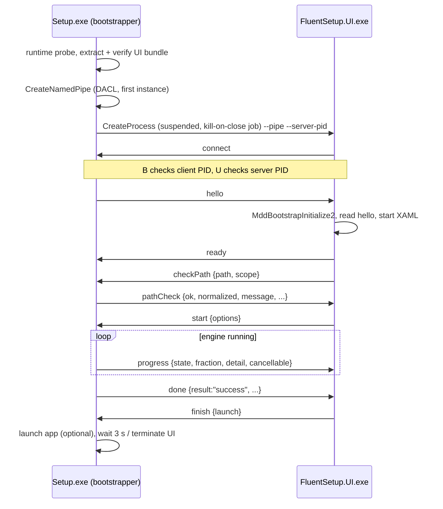
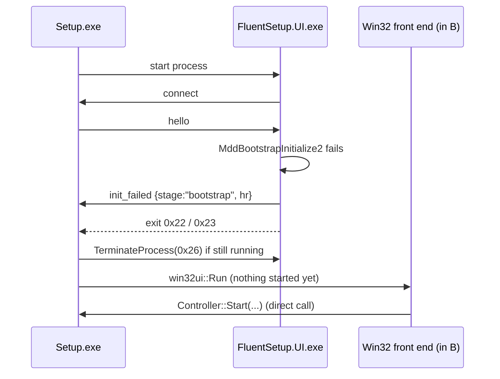
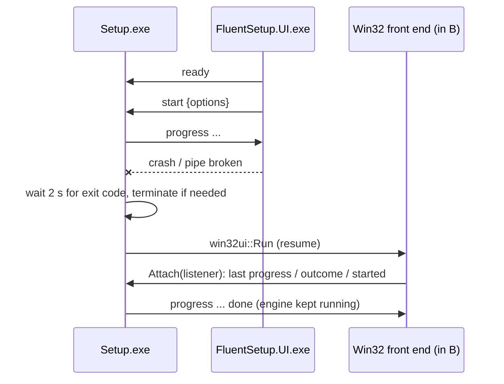
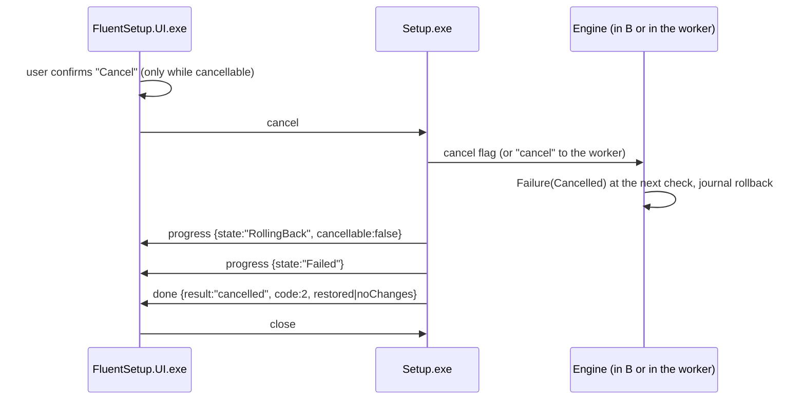
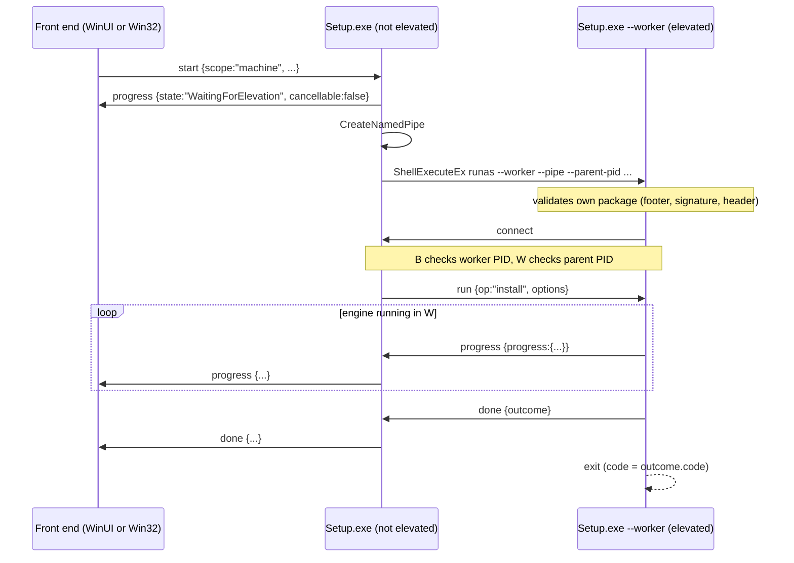

# FluentSetup IPC protocol (protocol version 1)

This page describes how the processes of a FluentSetup session talk to each other:

* **Bootstrapper** – `Setup.exe` / `uninstall.exe` (`src/Bootstrapper`). Owns the session (`boot::Controller`), runs
  the install engine and is the pipe **server** for both channels below.
* **WinUI front end** – `FluentSetup.UI.exe` (`src/Setup.WinUI`), started by the bootstrapper from a verified,
  extracted bundle. Pipe **client**.
* **Elevated worker** – the same `Setup.exe` started elevated with `--worker` (`src/Install.Worker/worker.cpp`). Runs
  the engine for per-machine operations. Pipe **client**.

The Win32 front end (`src/Setup.Win32`) runs inside the bootstrapper process and talks to the controller directly
(C++ calls, no IPC). It receives the same data as the WinUI front end (`Controller::Hello`, `DoneMessage`).

Sources: `src/IPC/pipe.h/.cpp`, `src/IPC/protocol.h`, `src/Bootstrapper/winui_host.cpp`, `controller.cpp`,
`elevation.cpp`, `main.cpp`, `args.cpp`, `src/Setup.WinUI/main.cpp`, `UiChannel.*`, `MainWindow.xaml.cpp`,
`App.xaml.cpp`, `src/Install.Worker/worker.cpp`, `src/Install.Core/engine.cpp` (JSON helpers).

## 1. Transport (`ipc::Channel`)

| Aspect | Value |
|---|---|
| Pipe name | `\\.\pipe\FluentSetup-<32 lowercase hex digits>` (128 random bits, a new name per channel) |
| Server creation | `CreateNamedPipeW` with `PIPE_ACCESS_DUPLEX \| FILE_FLAG_OVERLAPPED \| FILE_FLAG_FIRST_PIPE_INSTANCE`, `PIPE_TYPE_BYTE \| PIPE_READMODE_BYTE \| PIPE_WAIT \| PIPE_REJECT_REMOTE_CLIENTS`, max. 1 instance, 64 KiB in/out buffers |
| DACL | `D:P(A;;GA;;;<SID of the server's user>)(A;;GA;;;BA)(A;;GA;;;SY)` – protected; current user, Administrators, SYSTEM. Administrators are admitted because an over-the-shoulder elevated worker runs as a different user. |
| Client open | `CreateFileW(GENERIC_READ \| GENERIC_WRITE, FILE_FLAG_OVERLAPPED \| SECURITY_SQOS_PRESENT \| SECURITY_IDENTIFICATION)` – the server may identify but not impersonate the client. Retries until the timeout: `ERROR_FILE_NOT_FOUND` → sleep 50 ms, `ERROR_PIPE_BUSY` → `WaitNamedPipeW(200 ms)`, other errors abort. |
| Framing | `uint32` little-endian byte length, followed by that many bytes of UTF-8 JSON |
| Message size | 1 … 16 MiB (`kMaxMessageBytes`). A zero or larger length is treated as a broken channel. Oversized messages are not sent (`Send` returns false). |
| Message body | Must parse as a JSON **object** (nesting depth ≤ 32). Anything else is treated as a broken channel. |
| Message type | String member `"t"`. Receivers ignore types they do not handle. |
| Writes | Thread-safe (mutex), whole frame; each overlapped write waits at most 30 s. |
| Reads | One reader thread at a time; optional timeout and cancel event (both abort the pending read with `CancelIoEx`). |

There is no request id: replies are matched by type (and, for `pathCheck`, by the echoed path).

### 1.1 Peer verification

Both sides check the PID of the process at the other end of the pipe:

| Channel | Server check | Client check |
|---|---|---|
| Bootstrapper ↔ UI | `GetNamedPipeClientProcessId` must equal the PID returned by `CreateProcessW`, else the UI is terminated and the bootstrapper falls back ("unexpected pipe client"). | `GetNamedPipeServerProcessId` must equal `--server-pid`, else the UI closes the pipe and exits with `0x21`. |
| Bootstrapper ↔ worker | Client PID must equal `GetProcessId` of the process handle returned by `ShellExecuteExW`, else the worker is terminated and the operation fails with `Internal` (14). | Server PID must equal `--parent-pid`, else the worker exits with `Internal` (14). |

`FILE_FLAG_FIRST_PIPE_INSTANCE` makes server creation fail if any process already owns that pipe name.

## 2. Bootstrapper ↔ WinUI front end

### 2.1 Launch

`boot::RunWinUi` (only if the package has a front end and `/ui win32` / `/quiet` were not given):

1. Runtime probe (`ProbeWindowsAppRuntime`, see `docs/diagnostics.md`). Skipped for `--ui-simulate runtime-missing`.
2. Extract the `frontend` file set into a new private directory `%TEMP%\FluentSetup-<16 hex>`; every file is verified
   and kept open deny-write until the session ends; the directory is deleted afterwards.
3. Create the server pipe, then start the UI **suspended**, assign it to a job object with
   `JOB_OBJECT_LIMIT_KILL_ON_JOB_CLOSE` (the UI dies with the bootstrapper), and resume it. Working directory = bundle
   directory. Command line:

   ```
   "<bundle>\FluentSetup.UI.exe" --pipe FluentSetup-<hex> --server-pid <bootstrapper PID> [--simulate <mode>]
   ```

Arguments accepted by `FluentSetup.UI.exe` (each must be followed by a value; anything else → exit `0x20`):

| Argument | Meaning |
|---|---|
| `--pipe <name>` | Bare pipe name (without `\\.\pipe\`). |
| `--server-pid <pid>` | Expected PID of the pipe server. |
| `--simulate <mode>` | Test hook, forwarded from Setup.exe `--ui-simulate`: `runtime-missing`, `crash-before-ready`, `crash-after-ready`, `hang`. |
| `--preview <file>` | Builder preview: no pipe; `hello` is read from a JSON file, nothing is sent, and progress/completion are simulated locally. |

### 2.2 Handshake and timeouts

| Step | Who | Timeout / rule |
|---|---|---|
| Wait for the client to connect | Bootstrapper | `kConnectTimeoutMs` = 10 s; the wait also ends if the UI process exits. |
| Connect to the pipe | UI | Retries for 10 s, then exit `0x21`. |
| Verify peers | both | Section 1.1. |
| Send `hello` | Bootstrapper | Sent immediately after the client PID check. |
| Bind the Windows App Runtime | UI | `MddBootstrapInitialize2` (before reading `hello`). Failure → `init_failed {stage:"bootstrap"}` and exit `0x22`/`0x23`. |
| Read `hello` | UI | 10 s; must have `t = "hello"` and `proto = 1`, else exit `0x26`. |
| Start XAML | UI | `Application::Start`; an exception → `init_failed {stage:"xaml"}` and exit `0x24`. |
| Send `ready` | UI | After the main window's root element is loaded (low-priority dispatcher callback). The UI starts its reader thread right after. |
| Wait for `ready` | Bootstrapper | `kUiReadyTimeoutMs` = 20 s, counted from after `hello` was sent. |

While waiting for `ready` the bootstrapper handles exactly three message types: `ready` (continue), `init_failed`
(fall back), `close` (the user closed the window before it became ready: the session ends as closed by the user, no
fallback). A timeout, a broken pipe or the UI exiting also lead to the fallback. Any failure before `ready` terminates
the UI with exit code `0x26` and yields **FallbackFresh**: nothing has been started, the Win32 front end begins at its
first page.

After `ready`, the bootstrapper attaches the WinUI bridge to the controller and processes messages until the session is
finished. If the channel breaks before that (UI crash, kill, pipe error), the UI is terminated if still running and the
result is **FallbackResume**: the Win32 front end attaches to the same controller and shows the current state (progress
of a running operation, the result of a finished one, or the first page). The WinUI front end is never restarted.

When the session is finished (`finish`, or `close` while no operation is running), the bootstrapper waits up to 3 s for
the UI to exit and then terminates it with `0x26`.

### 2.3 Messages: UI → bootstrapper

| `t` | Fields | Handling |
|---|---|---|
| `ready` | – | Handshake complete (only meaningful during the handshake). |
| `init_failed` | `stage`: `"bootstrap"` (runtime binding), `"xaml"` (XAML start), `"unhandled"` (XAML `UnhandledException`); `hr`: HRESULT as unsigned number | During the handshake: fallback (FallbackFresh); the stage and HRESULT go to the log. After `ready` the message is ignored; the UI exits right after sending it (`0x25` for `unhandled`), which leads to FallbackResume. |
| `checkPath` | `path`: string; `scope`: `"user"` or `"machine"` (anything else = user) | Replied to with `pathCheck`. If the scope is not allowed by the package, the package's default scope is used. |
| `start` | `options`: see below | Install mode: options are validated (`SanitizeOptions`); if rejected, a `done` with code 3 is sent and the session continues. Uninstall mode: `options` is ignored and the defaults are used. Starts the operation asynchronously; ignored while one is running. May be sent again after a failed `done` (the "Try again" button returns to the first page). |
| `cancel` | – | Sets the controller's cancel flag and forwards `cancel` to the elevated worker if one is running. The engine checks the flag between files and before the non-cancellable phases; after that the operation completes normally. |
| `finish` | `launch`: bool | Ends the session. If `launch` is true and launching is possible (install mode, `launchAfterInstall` not `off`, successful result with a main executable), the app is started as the desktop user. |
| `close` | – | If no operation was started, the session is marked as closed by the user. If no operation is running, the session ends. |

`start.options`:

| Field | Type | Rules (`OptionsFromJson` + `SanitizeOptions`) |
|---|---|---|
| `installDir` | string | Required, ≤ 1024 chars. Must equal the default directory for the scope if the package does not allow a custom directory or the app is already installed. |
| `scope` | `"user"` / `"machine"` | Required. Must be allowed by the package; must equal the installed scope when updating. |
| `desktopShortcut`, `startMenuShortcut` | bool | Default false / true. Replaced by the package default when the offer is not user-visible. |
| `choices` | object `{optionId: bool}` | ≤ 16 entries, ids ≤ 32 chars, values must be booleans, every id must be defined by the package; missing ids keep their defaults. |

### 2.4 Messages: bootstrapper → UI

#### `hello` (`Controller::Hello`)

| Field | Content |
|---|---|
| `t` | `"hello"` |
| `proto` | `1` (`ipc::kProtocolVersion`); the UI refuses other values. |
| `mode` | `"install"` or `"uninstall"` |
| `elevated` | bool – whether the bootstrapper runs elevated |
| `strings` | Complete localized string table (en-US base, zh-CN overlay, package overrides) |
| `language` | `"en-US"` or `"zh-CN"` |
| `app` | `{name, publisher, version, iconPath}` – `version` is the installed version in uninstall mode; `iconPath` is the extracted `app.ico` (empty if none) |
| `ui` | `{theme, backdrop, useSystemAccent, accentColor, title, welcomeText, finishText}`, plus `licenseText` (localized license, else the default license) only for a fresh install |
| `options` | `{installDir, scope, canChangeDir, canChangeScope, userDir, machineDir, dirLeaf, desktopShortcut, startMenuShortcut, launchAfter, choices, dirOk, dirMessage}` – the three offers are `{visible, value}`; `choices` is `[{id, label, value}]` (install mode only); `dirOk`/`dirMessage` are the result of checking the default directory (install mode; always `dirOk: true` in uninstall mode) |
| `existing` | `{relation: "none"\|"upgrade"\|"same"\|"downgrade", version, blocked}` – `relation` is always `"none"` in uninstall mode; `blocked` = downgrade not allowed (install mode) |
| `runningApps` | Comma-separated names of running `closeProcesses` that will be closed |
| `requiredBytes`, `freeBytes` | Space estimate for the default directory |

#### `pathCheck` (reply to `checkPath`)

`{t, path, normalized, ok, message, requiredBytes, freeBytes}`. `path` echoes the request (the UI discards replies
whose `path` is not its latest request). `message` is the localized `path.*` text (empty when `ok`); for
`path.space` it contains the required and available sizes. Writability is probed only for per-user targets.

#### `progress`

`{t: "progress", state, fraction, detail, cancellable}`

* `state`: `Idle`, `Validating`, `WaitingForElevation`, `Preparing`, `Extracting`, `Installing`, `Registering`,
  `Finalizing`, `Removing`, `Completed`, `Cancelling`, `RollingBack`, `Failed`.
* `fraction`: 0…1, or negative for indeterminate.
* `detail`: usually the relative path of the file being processed.
* `cancellable`: false from `Registering` on, during rollback and while waiting for elevation.

The engine emits progress at most every 40 ms unless the state changes.

#### `done` (`Controller::DoneMessage`)

| Field | Content |
|---|---|
| `result` | `"success"`, `"cancelled"` or `"failed"` |
| `code`, `codeName` | `ErrorCode` value and name (see `docs/diagnostics.md`) |
| `message` | Localized `error.<codeName>` text formatted with `{0}` = app name, `{1}` = detail |
| `detail` | English diagnostic text |
| `warnings` | Array of English texts for non-fatal problems |
| `log` | Log file path |
| `installDir` | Install directory of the operation |
| `canLaunch` | Success and the app can be launched |
| `launchDefault` | Default state of "launch after install" |
| `restored` | Rolled back and a previous installation was involved (always true for a rolled-back uninstall) |
| `noChanges` | Rolled back and nothing was installed before |
| `leftovers` | Uninstall: the install directory still contains files setup did not install |
| `retryable` | False for codes 3, 4, 5, 10, 11, 16 |

There is no message from the bootstrapper that closes the UI; the UI closes its window itself after sending `finish`
or `close`, and the bootstrapper terminates it after 3 s if it is still running. If the UI's reader thread sees the
pipe break, it shows a local failure page (`code 14`, `error.peerLost`).

### 2.5 UI process exit codes (`ipc::UiExitCode`)

They only tell the bootstrapper why the WinUI front end could not be used; they never become Setup.exe exit codes.
Values ≥ `0x20` do not collide with `ErrorCode`.

| Code | Name | Meaning |
|---|---|---|
| `0x00` | `kUiExitOk` | Normal exit. |
| `0x20` (32) | `kUiExitBadArguments` | Unknown/missing argument, missing `--pipe`/`--server-pid`, or unreadable `--preview` file. |
| `0x21` (33) | `kUiExitPipeConnectFailed` | Could not connect within 10 s, or the server PID did not match. |
| `0x22` (34) | `kUiExitRuntimeNotFound` | `MddBootstrapInitialize2` returned `HRESULT_FROM_WIN32(ERROR_NO_MATCH)`: no compatible Windows App Runtime. |
| `0x23` (35) | `kUiExitRuntimeInitFailed` | Any other failure binding the runtime, including a missing `Microsoft.WindowsAppRuntime.Bootstrap.dll`. |
| `0x24` (36) | `kUiExitXamlStartFailed` | `Application::Start` threw. |
| `0x25` (37) | `kUiExitUnhandledException` | XAML `UnhandledException` after start. |
| `0x26` (38) | `kUiExitProtocolError` | Invalid or missing `hello` / protocol mismatch. Also the code the bootstrapper uses when it terminates the UI. |

### 2.6 Sequence: normal install (per-user)



### 2.7 Sequence: WinUI fails before `ready` (FallbackFresh)



The same path is taken, without any message, when the probe finds no compatible runtime (the UI is never started),
when the UI does not connect within 10 s, when the PIDs do not match, or when `ready` does not arrive within 20 s.

### 2.8 Sequence: WinUI stops after `ready` (FallbackResume)



### 2.9 Sequence: cancel



## 3. Bootstrapper ↔ elevated worker

Used when the operation targets the machine scope and the bootstrapper is not elevated (`Controller::RunElevated`).

### 3.1 Launch

* The controller publishes `progress {state: "WaitingForElevation", cancellable: false}`.
* It creates a new server pipe (same transport as section 1) and starts its own executable through
  `ShellExecuteExW` with verb `runas`, `SW_HIDE`, and the owner window set to the visible WinUI window (if any) so the
  UAC prompt comes to the foreground. Parameters:

  ```
  --worker --pipe FluentSetup-<hex> --parent-pid <bootstrapper PID>
      [/uninstall] [--origin-dir "<dir>"] [--wait-pid <pid of the original uninstaller>]
      [/log "<log file>"] /lang <en-US|zh-CN>
  ```

  `--wait-pid` is only passed by an uninstaller running in phase 2. The worker opens and validates its own package
  exactly like a normal start (container, signature, header) before it connects.
* If the elevation request fails, the operation ends with `ElevationRequired` (6); "The administrator permission
  request was declined" if the user declined UAC.

### 3.2 Worker checks

The worker exits with `Internal` (14) unless: it is elevated; the `--parent-pid` process can be opened; it connects
within 10 s and the server PID equals `--parent-pid`; a `run` message arrives within 60 s; `op` is `install` or
`uninstall`, matches the presence of `/uninstall`, and is not `install` for an uninstaller package. Malformed install
options → `InvalidArguments` (3). The worker does not re-apply the front-end option policy (`SanitizeOptions`); the
engine's own checks (scope allowed, path checks, elevation) still apply.

The bootstrapper waits up to 60 s for the worker to connect (the wait ends early if the worker exits) and verifies the
client PID; failure → `Internal` (14), and the worker is terminated.

### 3.3 Messages

| Direction | `t` | Fields |
|---|---|---|
| bootstrapper → worker | `run` | `op`: `"install"` / `"uninstall"`; `options`: `{installDir, scope, desktopShortcut, startMenuShortcut, choices}` (ignored for uninstall) |
| bootstrapper → worker | `cancel` | – (sent when the front end cancels, also if cancel was requested before the worker connected) |
| worker → bootstrapper | `progress` | `progress`: `{state, fraction, detail, cancellable}` (nested, unlike the UI message) |
| worker → bootstrapper | `done` | `outcome`: `{code, detail, rolledBack, upgrade, leftovers, installDir, mainExecutable, deferred[], warnings[]}` |

The controller republishes worker progress to the current front end and turns `done` into the front end's `done`
message. Out-of-range codes in `outcome.code` are mapped to `Internal`.

Failure handling:

* If the bootstrapper's pipe breaks during the operation (bootstrapper closed or crashed), the worker's reader thread
  sets the cancel flag: the engine stops and rolls back instead of finishing unobserved.
* If the worker disappears without `done`, the operation result is `Internal` (14) with "The elevated worker stopped
  unexpectedly (exit code …). Its journal will be rolled back the next time setup runs." (see the recovery section in
  `docs/diagnostics.md`).
* After sending `done`, an uninstall worker with deferred deletions waits (up to 60 s) for the `--wait-pid` process and
  then deletes the remaining files. Its exit code is the outcome code.

### 3.4 Sequence: per-machine install via the worker



## 4. Versioning

`hello.proto` carries `ipc::kProtocolVersion` (1); the UI refuses any other value (exit `0x26` → fallback). The worker
channel has no version field: the worker is always the same executable as the bootstrapper. The UI bundle is always
extracted from the package that is running, so all three processes come from one build. Unknown message types and
unknown fields are ignored by all receivers.
